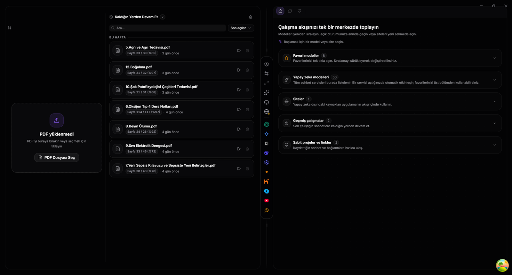
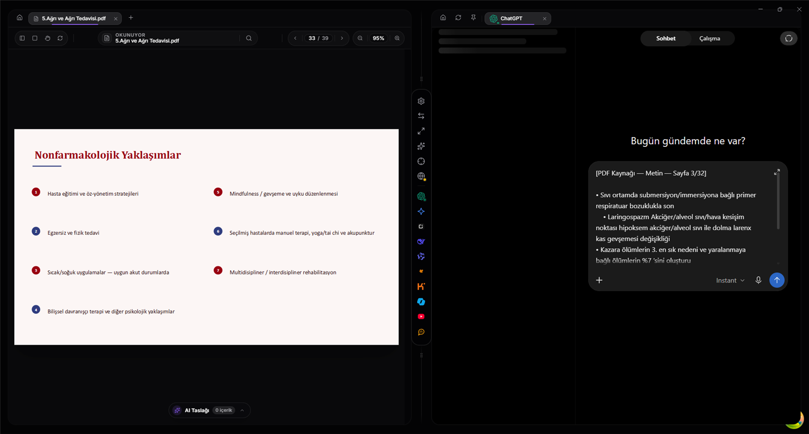
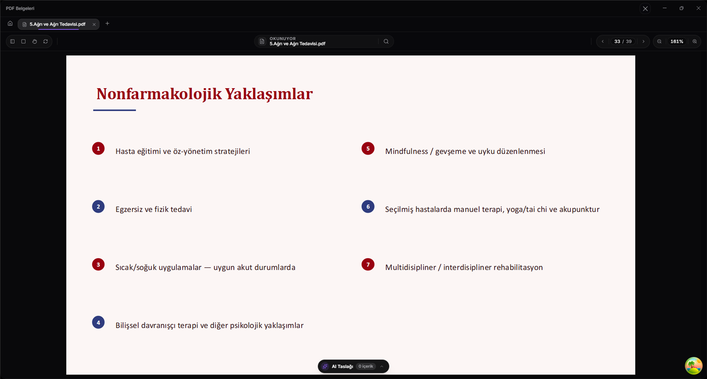
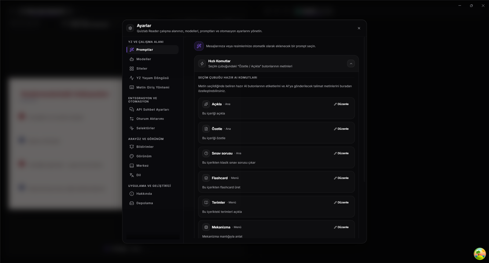
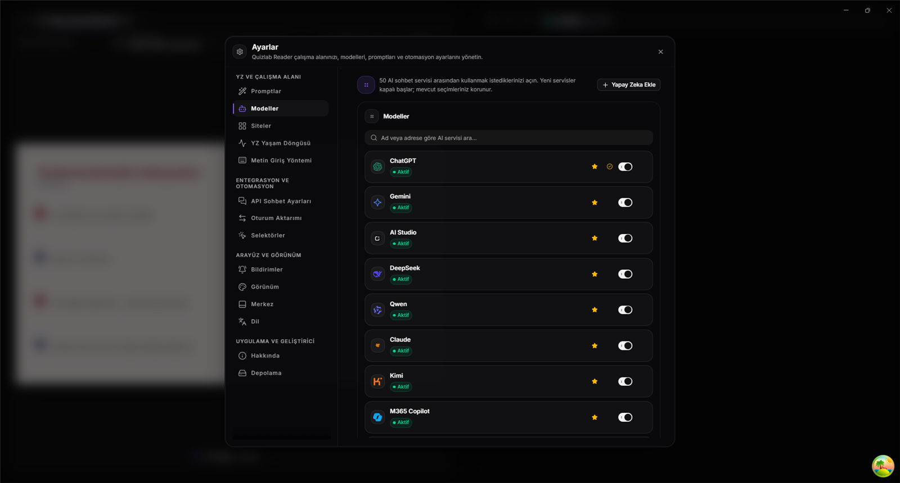
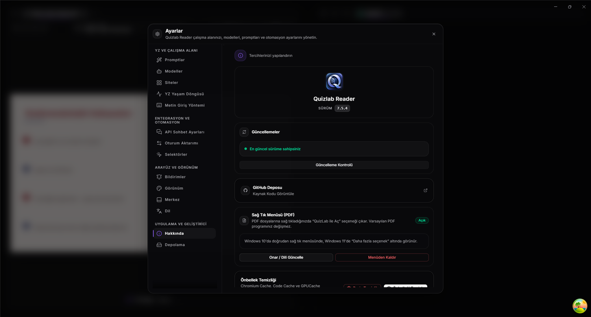
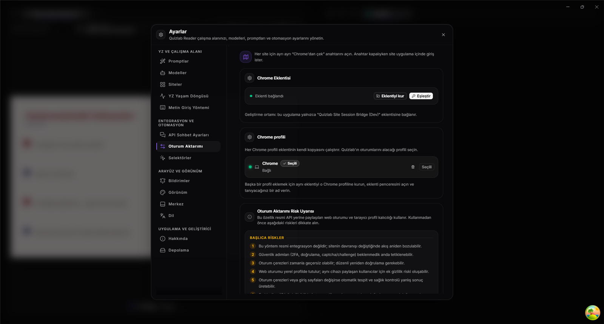
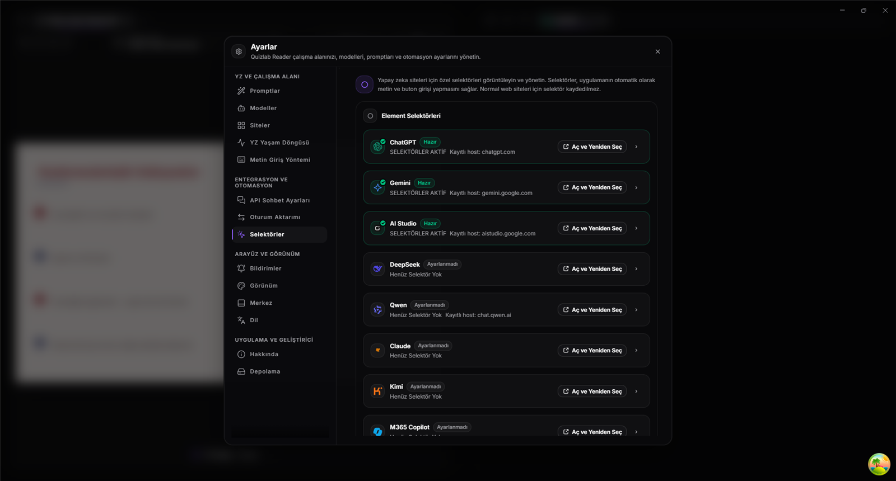
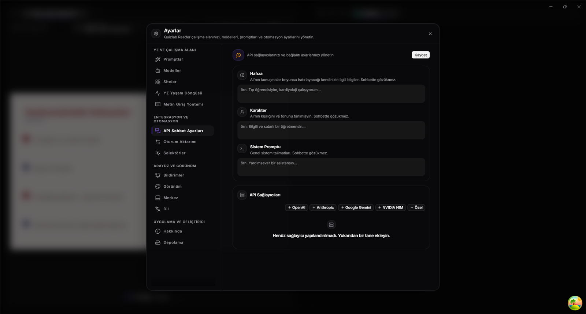
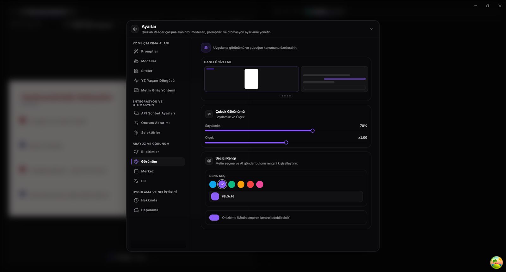

# Quizlab Reader

<p align="center">
  A local-first desktop workspace for reading PDFs side by side with AI assistants.
</p>

<p align="center">
  <a href="README_TR.md">Türkçe</a>
  &nbsp;•&nbsp;
  <a href="https://github.com/ozymandias-get/quizlab/releases">Releases</a>
  &nbsp;•&nbsp;
  <a href=".github/CONTRIBUTING.md">Contributing</a>
  &nbsp;•&nbsp;
  <a href=".github/SECURITY.md">Security</a>
  &nbsp;•&nbsp;
  <a href="docs/ARCHITECTURE.md">Architecture</a>
  &nbsp;•&nbsp;
  <a href="docs/ROADMAP.md">Roadmap</a>
  <br>
  
</p>

---

## Overview

Quizlab Reader keeps a PDF reader and a set of AI assistants in one window. The
left panel is a multi-tab PDF workspace; the right panel holds tabbed AI
sessions, each hosted in a main-owned `WebContentsView` with a persistent
Chromium session partition. Selected text, page images and cropped screenshots are collected in a
floating send composer and delivered into the active AI tab through DOM
automation, so you never have to leave the document you are reading.

It is built for people who read papers, lecture notes and textbooks and want to
ask an AI about them. The app bundles no analytics and never uploads your
documents: everything it writes stays under its own user-data folder on your
machine. Network traffic only happens where you point it — the AI sites you
open, the model providers you configure, the localhost cookie bridge, and a
GitHub Releases lookup for the update notifier.

## Screenshots

**Workspace home** — every registered model and site in one launchpad, next to
the PDF panel and the tool hub:



**Reading and sending** — a PDF page on the left, ChatGPT on the right, and PDF
text staged in the send composer:



**Focus mode** — the same document expanded to full width, without the AI panel:



**Settings** — the settings modal groups its tabs into AI & Workspace,
Automation & Integrations, Interface & Appearance, and System & Diagnostics.

Prompts — quick commands and the prompt library:



Models — enable, reorder and pin the models you use, or add your own:



About — version, update check, Windows right-click menu, cache cleaning and
diagnostics:



Session import — per-site "Pull from Chrome" switches, profile pairing and the
risks of cookie import:



Selectors — the Magic Picker's saved selectors and health per AI site:



API chat — provider templates and optional stored instructions:



Appearance — hub opacity and scale, and the selection colour:



## Features

- **Multi-tab PDF workspace** — open, rename and close documents, search, zoom,
  page navigation, reading-progress history, drag and drop, plus a Google Drive
  tab. Drop a PDF on the left panel or use the file picker in the PDF toolbar;
  PDF search opens from the toolbar.
- **Split-screen layout** — a draggable divider sets the PDF/AI ratio, and focus
  mode expands either the PDF or the AI side to full width.
- **Tabbed AI sessions** — ChatGPT, Gemini, AI Studio, YouTube, DeepSeek, Qwen,
  Claude, Kimi and M365 Copilot are registered out of the box; NotebookLM is
  available through the Google site group (opt in), and custom sites can be
  added. Each site runs in its own persistent session, so logins survive
  restarts. An `API Chat` tab provides a native, renderer-drawn chat surface.
- **Send composer** — selected text, a whole page as text or as an image, or a
  cropped area image are queued and combined into a single outgoing message in
  the order they were added (images attach to that one message; one submit).
  Auto Send is a global preference: with it off, the app only stages content and
  you press send on the site yourself.
- **Quick prompts** — eight built-in presets (explain, summarize, quiz,
  flashcard, terms, mechanism, clinical, review) that prepend a prompt to the
  outgoing message; labels and prompt text are user-editable.
- **Magic Picker** — pick a chat input and send button on any AI site with the
  mouse instead of writing CSS. Selectors are stored per hostname and
  self-heal: when a saved selector breaks, the runtime recovers a replacement
  and promotes it only after confidence and flapping checks and three
  consecutive successful sends.
- **Direct API chat** — bring your own API key and talk to models over an
  OpenAI-compatible `/chat/completions` and `/models` endpoint. All providers —
  including the Anthropic, Google and NVIDIA templates — use that OpenAI-shaped
  wire format; `providerType` only selects the base URL and input hints.
  Templates ship for OpenAI, Anthropic, Google and NVIDIA, and `custom` covers
  any compatible gateway. Requests come from the main process with SSRF
  validation and DNS pinning (TLS SNI preserved). HTTPS is required by default;
  plain HTTP is allowed for `localhost`/`127.0.0.1` and, with the per-provider
  `Allow local network` consent, for LAN/local-model addresses. Chat requests
  time out after 60 s by default; model listings default to 15 s and are capped
  at 30 s (both derived from the provider's `requestTimeout`). Request bodies are
  capped at 20 MB and responses at 50 MB.
- **Site sessions** — every site you use has its own "Pull from Chrome" switch
  in **Settings → Session Import**. With it on, the Chrome extension installed
  from that panel hands the site the cookies of your Chrome profile over a localhost bridge;
  with it off, the site asks you to sign in inside the app. Every site holds a
  single session in its own persistent cookie-jar partition, and the Google
  family (Gemini, AI Studio, YouTube, NotebookLM and Google Drive) shares one
  account group and one settings row.
- **Appearance** — configurable hub opacity and scale, a user-chosen selection
  colour (which also tints AI send buttons), and a configurable hub/dock for the
  tools and models you actually use.
- **Language** — English and Turkish, selectable on first run and changeable in
  settings. 17 per-domain JSON bundles per language.
- **Storage and cache management** — measured cache totals, a scheduled cleanup
  routine (startup, idle and 30-minute repeat) and a warning toast at 80% of the
  1 GB budget.
- **Update notifier** — checks the GitHub Releases API about five seconds after
  start, compares a simplified numeric version (major.minor.patch; pre-release
  tags are not ranked) and offers a link to the release page. It never downloads
  or installs anything.
- **Windows shell integration** — an optional "Open with QuizLab" entry in the
  Explorer right-click menu for `.pdf` files, without taking over your default
  PDF handler.

## Tech Stack

| Area             | Choice                                                                             |
| ---------------- | ---------------------------------------------------------------------------------- |
| Desktop runtime  | Electron 45                                                                        |
| UI               | React 19, no router (custom state-driven workspace)                                |
| Language         | TypeScript 6                                                                       |
| Build            | Vite 8 (renderer), `tsc` + esbuild (main/preload), electron-builder (packaging)    |
| PDF engine       | `pdfjs-dist@6.5.438` with QuizLab's own native viewer, worker `pdf.worker.min.mjs` |
| Styling          | Tailwind CSS 4 (`@theme` tokens), plus a small number of CSS modules               |
| State            | Zustand 5 for cross-component state, TanStack React Query 5 for IPC-backed reads   |
| UI primitives    | Radix UI, Headless UI, shadcn/ui, Lucide icons                                     |
| Motion / effects | Motion, Inter Variable (Fontsource), custom canvas particle effects                |
| i18n             | i18next + react-i18next                                                            |
| Tests            | Vitest 5 + Testing Library                                                         |
| Lint / format    | ESLint 10, Prettier, Stylelint, cspell, dependency-cruiser                         |
| Security tooling | Electronegativity, Semgrep, `npm audit`                                            |
| Packaging        | electron-builder 26 — NSIS (Windows), dmg/zip (macOS), AppImage/deb (Linux)        |

## Requirements

**To run the app**

- Windows 10/11 (x64) — the published installer is a per-user NSIS package. The
  Explorer right-click entry is Windows-only; the localhost Chrome cookie bridge
  is cross-platform and runs wherever the app runs.
- macOS — `dmg`/`zip` targets are configured, but the release workflow does not
  build macOS; produce it locally with `npm run build:mac`. Electron 45 (Chromium 156) ships macOS binaries for Ventura 13 and newer.
- Linux — AppImage and `deb` are built in CI.
- A network connection is required for AI features. Nothing else is needed to
  read PDFs.

**To build from source**

- Node.js `24.15+` or `26+` (CI exercises both 24 and 26; the floor comes from
  jsdom 31's `engines` range, which is stricter than the ranges Vite and Vitest
  publish)
- npm — the lockfile is `package-lock.json` and CI uses `npm ci`
- Git
- A Google account, only if you want to use the Google sites (Gemini, AI Studio,
  YouTube, Google Drive)
- API keys, only if you want the direct API chat
- Google Chrome, only if you want the session-bridge extension

## Installation

Download the installer for your platform from
[Releases](https://github.com/ozymandias-get/quizlab/releases).

| Platform | Artifact                                                     |
| -------- | ------------------------------------------------------------ |
| Windows  | `QuizLab-Setup-<version>-x64.exe` — NSIS, per-user, no admin |
| Linux    | `.AppImage` (run directly) or `.deb` (install with `dpkg`)   |
| macOS    | Not built by CI — run `npm run build:mac` locally            |

The Windows installer is unsigned, so SmartScreen will warn on first run. It
installs per user, never requests elevation, and leaves `%AppData%\Quizlab Reader`
in place on uninstall. The optional Explorer right-click entry is registered per
user under `SystemFileAssociations\.pdf` and does not change the default PDF
handler. See [docs/windows-installer.md](docs/windows-installer.md) for the full
install story, including code-signing variables.

## Configuration

Almost everything is configured in the app. There is no config file to edit and
no `.env` loader: the Electron main process reads `process.env` directly, so
variables must be exported in the shell that launches it. `.env.example`
documents the full list with defaults; the ones that matter in development are:

| Variable                        | Effect                                                                                                            |
| ------------------------------- | ----------------------------------------------------------------------------------------------------------------- |
| `APP_RENDERER_URL`              | Dev-server URL the main window loads (default `http://localhost:5173`)                                            |
| `APP_OPEN_DEVTOOLS=1`           | Open DevTools on startup                                                                                          |
| `QUIZLAB_PROFILE`               | Suffix for the user-data directory (see below)                                                                    |
| `QUIZLAB_USER_DATA_DIR`         | Absolute path override for user data                                                                              |
| `QUIZLAB_DISABLE_GPU=1`         | Disable hardware acceleration                                                                                     |
| `QUIZLAB_EXTENSION_BRIDGE_PORT` | Localhost port for the Chrome cookie bridge; the release app uses `51999-52009`, `npm run dev` uses `52010-52020` |

Using a `QUIZLAB_PROFILE` other than `stable` also disables the single-instance
lock, which is useful for running two profiles side by side.

**Where data lives.** The app relocates its user-data directory before anything
else runs, so profiles never mix:

| Profile  | Directory                                                          |
| -------- | ------------------------------------------------------------------ |
| `stable` | `<appData>/Quizlab Reader` — `%AppData%\Quizlab Reader` on Windows |
| `dev`    | `<appData>/Quizlab Reader Dev` (unpackaged runs)                   |
| other    | `<appData>/Quizlab Reader <profile>`                               |
| override | `QUIZLAB_USER_DATA_DIR`                                            |

Inside it: JSON configuration files, `Partitions/<name>/` Chromium session and
cache data, `logs/`, and the bridge secret shared with the Chrome extension. The
extension ships with the app as `resources/extension`; pressing Install in
Settings → Session Import copies it to a stable folder in the user-data
directory. CI also publishes it as a standalone `quizlab-session-extension.zip`.
There is no database.

**API keys** are stored in `api_chat_config.json` (written with mode `0600` on
POSIX; Windows ACLs are unchanged) encrypted with Electron `safeStorage` where
the OS keychain is available, and otherwise with AES-256-GCM under a key derived
from a machine fingerprint via PBKDF2. The fallback obfuscates the value at rest;
it is not a substitute for a keychain.

## Usage

1. Launch the app. On first run, pick a language.
2. Drop a PDF on the left panel or use the file picker in the PDF toolbar. A tab
   opens per document.
3. Open an AI site from the home panel on the right, or add your own under
   **Settings → Sites**. Sign in once; the session is remembered.
4. Select text in the PDF, or right-click the page for _Add This Page's Text to
   AI_ / _Send Page as Image to AI_ / _Add Area Selection as Image to AI_.
5. Content lands in the send composer, where the queue is combined into one
   message in the order it was added. Pick a quick prompt if you want one, then
   press **Send to AI**.
6. Turn on **Auto Send** in the composer if you would rather not press send on
   the site each time.
7. If a site's layout changes, run **Magic Picker** on that tab and re-pick the
   input. Until you do, the app refuses to send rather than typing into the
   wrong element.

## Architecture

```
Renderer (src/)
  React workspace: PDF panel, AI host placeholders, send composer, settings
  AiContentController: remote commands and generation-filtered state
  hooks + TanStack Query over window.electronAPI
         |  typed invoke (channel -> request/result types)
         v
Preload (electron/preload/)
  contextBridge: explicit allowlist — no generic invoke(channel, ...) passthrough
         |  ipcRenderer.invoke
         v
Main (electron/)
  typed ipcMain handlers; trusted-sender check on every contract handler
  (the screen-share picker uses isolated per-instance channels)
  feature modules: ai-view, ai, automation, native-messaging,
                   pdf, screenshot, settings, shell-open, web-session
  core: config store, encryption, CSP, logging, cache accounting, updater
         |
         +--> local-pdf:// protocol  -> local PDF files (allowlist, byte ranges)
         +--> AiWebContentsViewManager -> WebContentsView / provider partitions
         |                            remote commands and event bridge
         +--> remoteContentSecurity -> navigation, popups, TLS, clipboard
         +--> permissionPolicy      -> partition + registered origin permissions
         +--> model provider HTTP   -> direct API chat (SSRF-validated)
         +--> GitHub Releases API   -> update notifier
```

Shared contracts live in `shared/`: channel names
(`shared/constants/ipcChannels.ts`, 67 channels) and the request/result map
(`shared/types/ipcContract.ts` — `IpcInvokeRequestMap` and `IpcEventMap`). The
`@shared-core/*` alias resolves to `shared/` in tsconfig and Vite; renderer code
and tests use it, while preload and main runtime imports use relative `.js`
paths.

Two design points worth knowing before changing things: navigation is state,
not routing — there is no router, and the PDF tabs (Zustand) and AI tabs
(`useState` behind split contexts) are independent; and web-session automation
uses `AiContentController` and typed IPC to run main-generated scripts in the
managed remote view. API Chat uses provider HTTP requests.

Host ownership and content lifecycle are independent. Unmounting a host
placeholder releases its ownership token and hides/mutes the native view, but
does not destroy it — focus mode reuses the same generation, URL and page state
with no reload. Tab close, LRU eviction and sleep retire the managed view; wake
attaches a fresh view with a new generation and keeps it hidden until its first
load settles. The default `maxAliveTabs` is 1, so switching tabs normally
retires the previous view too; raise it to keep more alive. Host bounds are
coalesced into one animation frame, and native views are hidden while a dialog,
overlay, tab switch or focus reveal covers them.

See [docs/ARCHITECTURE.md](docs/ARCHITECTURE.md) for layer boundaries, the
import rules enforced by dependency-cruiser, and the selector self-healing flow.

## Project Structure

```
electron/            Main process
  app/               Entry point, window creation, session/CSP/security, IPC wiring
  core/              Config store, encryption, logging, cache, updater, typed IPC
  features/          Feature handlers (ai, automation,
                     native-messaging, pdf, screenshot, settings, shell-open,
                     web-session)
  preload/           contextBridge surface
  __tests__/         Main-process tests
shared/              Cross-process contracts: IPC channels, types, constants
src/                 Renderer
  app/               Shell, providers, app effects, floating composer
  features/          ai, automation, onboarding, pdf, screenshot, settings
  platform/electron/ Adapters between the app and window.electronAPI
  shared/            Shared UI, hooks, i18n, styles, stores, lib
  __tests__/         Renderer tests
extensions/          Chrome extension for the site session bridge
installer/           NSIS custom installer logic
scripts/             Dev and build automation
docs/                Architecture, coding standard, terminology, roadmap
```

## Development

```bash
git clone https://github.com/ozymandias-get/quizlab.git
cd quizlab
npm install
npm run dev          # Vite dev server + Electron
```

`npm run dev` builds the main process, starts Vite on port 5173 (reusing it if
this app is already being served there), then launches Electron. It filters known
Chromium noise from Electron's stderr but prints everything else.

Other entry points:

| Command                | What it does                                                       |
| ---------------------- | ------------------------------------------------------------------ |
| `npm run dev:web`      | Vite only; the renderer runs in a browser against a stubbed API    |
| `npm run dev:electron` | Backend build, then Electron against an already-running dev server |

Quality gates — all of these run in CI:

```bash
npm run typecheck     # tsc -b (app, node, node.test projects)
npm run lint          # ESLint, zero warnings tolerated
npm run format:check  # Prettier
npm test              # Vitest, full suite
npm run test:coverage # Vitest with coverage thresholds
```

Five more command-level gates are blocking in CI (in addition to the lint,
format, typecheck and analysis steps in the workflow); run these locally too, or
a tagged release fails on a gate that was never mentioned:

```bash
npm run ci:check-hygiene        # no tracked build output, no non-portable git paths
npm run ci:check-version        # version badge + tag ↔ package.json
npm run ci:check-declarations   # Node floor and dependency floors ↔ installed tree
npm run check:audit             # production dependency advisories
npm run check:electron-security # Electronegativity on the Electron surface
```

Analysis tooling:

```bash
npm run analyze:architecture  # dependency-cruiser import rules
npm run analyze:circular      # madge
npm run analyze:duplicates    # jscpd
npm run analyze:deadcode      # knip
npm run analyze:types         # type-coverage
npm run analyze:css           # stylelint
npm run analyze:security      # Semgrep + npm audit + Electronegativity
npm run analyze:all           # all above except analyze:css; run analyze:css and analyze:bundle separately
```

Commit messages follow [Conventional Commits](https://www.conventionalcommits.org/)
and are checked by commitlint in the Husky `commit-msg` hook. The Husky
`pre-commit` hook also runs `ci:check-hygiene` (blocking), `ci:check-version`,
file-size and CSS checks (non-blocking), then lint-staged.

## Testing

Vitest 5 runs two projects configured in `vitest.config.mts`: `renderer` runs
`src/__tests__/` and the DOM-dependent `electron/__tests__/` suites (automation,
ai-view, settings and root-level tests) in `jsdom`, while `main` runs the
`electron/__tests__/app`, `/core`, `/preload` and `/features/{ai,pdf,screenshot,web-session,native-messaging,shell-open}`
suites in Node. For the current file and test count run `npm test` — the totals
move with every commit, so they are deliberately not restated here.

Coverage thresholds are enforced per scope in `vitest.config.mts` — globally
50% lines, with separate floors for `electron/features/web-session`,
`electron/features/automation`, `electron/core`, `electron/features/ai/apiChatHandlers`
and the PDF feature. `npm run analyze:mutation` runs Stryker.

## Build

```bash
npm run build         # renderer + main + preload into dist/
npm run build:web     # renderer only, for browser preview
npm run build:win     # then electron-builder --win  -> release/*.exe
npm run build:mac     # then electron-builder --mac  -> release/*.dmg, *.zip
npm run build:linux   # then electron-builder --linux -> release/*.AppImage, *.deb
```

Packaging output goes to `release/`. Only `dist/**` is packed into `app.asar`;
the icons and the Chrome extension are shipped as extra resources. The extension
is also published as a standalone zip in releases. Windows builds are unsigned
(`signExecutable: false`, `forceCodeSigning: false`); set `CSC_LINK` /
`CSC_KEY_PASSWORD` (or `WIN_CSC_LINK`) to sign — see
[docs/windows-installer.md](docs/windows-installer.md).

## CI/CD

`.github/workflows/build.yml` has four jobs and is release-only: it runs on `v*`
tags and on manual `workflow_dispatch`. A normal branch push or pull request does
not run it.

1. **quality** (ubuntu-latest, Node 24) — repository hygiene, declaration and
   version consistency, ESLint, Prettier, CSS lint, typecheck, dependency-cruiser,
   knip dead-code detection, tests with coverage, type-coverage guard, duplicate
   and circular dependency detection, a full build, Semgrep, production
   dependency audit and Electronegativity. File size and spell checks run with
   `continue-on-error: true` and are non-blocking.
2. **quality-node-26** (ubuntu-latest) — install, typecheck and tests on Node 26.
   `build` depends on it, so a failure here blocks the release.
3. **build** (windows-latest and ubuntu-22.04, on tags or manual dispatch) —
   produces the Windows and Linux installers and uploads them as artifacts.
4. **release** (ubuntu-latest, tags only) — downloads both artifact sets, adds
   `quizlab-session-extension.zip`, and creates a public, non-prerelease GitHub
   Release with a custom download/feature body followed by GitHub-generated
   notes.

`ci:check-version` checks the `v*` tag against `package.json` (accepting `vX.Y`
for `X.Y.0`) and verifies the dynamic version badge in both READMEs. Manual
dispatch runs jobs 1–3 but creates no release.

## Security and Privacy

Verified properties of this build:

- **Isolated renderer** — `contextIsolation: true`, `nodeIntegration: false`,
  `sandbox: true`, `webSecurity: true`, and `webviewTag: false`. Main creates
  remote `WebContentsView` instances with secure preferences and no Node access.
- **Main-owned remote views** — `AiViewTarget` resolves sources and partitions
  from main-process registries. Typed IPC accepts bounded view ids, host tokens,
  bounds and commands; renderer requests cannot supply partitions, preloads,
  WebContents ids or security preferences. A separate cache-clearing channel
  accepts a partition key that main resolves and checks against protected
  partitions.
- **Remote content policy** — main-frame navigation requires HTTPS; popups are
  denied with validated external handoff. `permissionPolicy` checks the partition
  and registered origin, TLS certificate errors are rejected, and clipboard
  guards preserve trusted user/app paste while blocking programmatic access.
- **Narrow preload bridge** — about 74 named methods over 67 channels, with no
  generic IPC passthrough. One channel (`get-automation-scripts`) fans out to six
  script methods; `getPathForFile` and `platform` read `webUtils`/`process`
  directly, and event channels are wrapped with `on()`/`send()`.
- **Sender validation** — every handler on the shared IPC contract requires the
  main frame of the main window (WebContents identity, allowed main-frame URL,
  main-frame check). The screen-share picker is a separate window with
  per-instance channels and validates its own WebContents instead.
- **No analytics** — no telemetry or crash-reporting SDK is bundled, and no user
  data is sent automatically. The only automatic outbound request is the GitHub
  Releases lookup for the update notifier. Crash reports are written to `logs/`
  inside the user-data folder and are kept; rolling `quizlab-*.log` files are
  deleted after 7 days.
- **PDF delivery** — `local-pdf://` resolves opaque ids from an in-process
  registry, requires the file to be on the allowlist, validates the request
  origin, and serves byte ranges.
- **Strict CSP** — in packaged builds a nonce-based policy is injected into the
  main frame; development builds use a nonce-less `unsafe-inline` CSP. Both
  declare a `frame-src` allowlist.
- **Outbound hardening** — API chat URLs must be HTTPS, except `localhost` /
  `127.0.0.1` and LAN/ULA addresses when the provider explicitly opted into
  local-network access. Hosts are checked against private and special-use space
  (link-local/metadata stays blocked even with consent), pinned to a resolved IP
  with TLS SNI preserved, and limited to five same-origin redirects.
  Cross-origin redirects are rejected; 301/302/303 that rewrite a body-carrying
  request to GET drop the `Authorization` header (307/308 retain it).
- **Bridge authentication** - the cookie bridge requires an exact extension
  origin and HMAC-SHA256 over the request body with the pairing code shared
  with the extension, compared in constant time, plus a 512 KB body cap and a
  cookie-domain allowlist. The installed app and `npm run dev` use separate port
  ranges, extension ids, origins and user-data directories, so their bridges and
  pairing secrets never meet.
- **Electronegativity and Semgrep** run in CI.

What this does **not** give you: live AI session cookies are stored by Chromium
in its own partition store and are not encrypted by the application; the
machine-derived AES key is obfuscation, not protection against someone with
access to your machine profile; and builds are unsigned.

## Contributing

See [CONTRIBUTING.md](.github/CONTRIBUTING.md) for setup, branch strategy, the pull
request checklist, and the coding rules in
[docs/CODING_STANDARD.md](docs/CODING_STANDARD.md).

## License

[MIT](LICENSE) © Quizlab Reader contributors.
