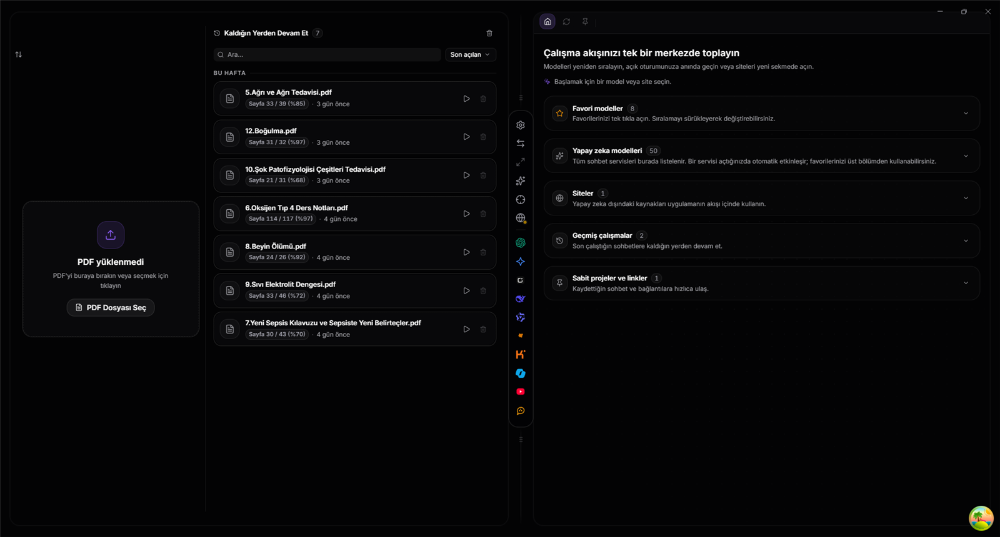
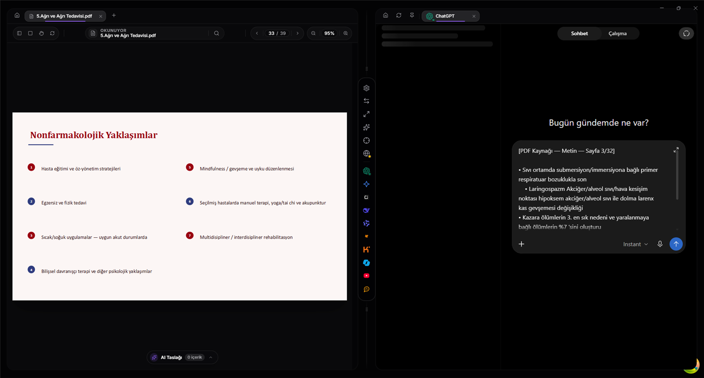
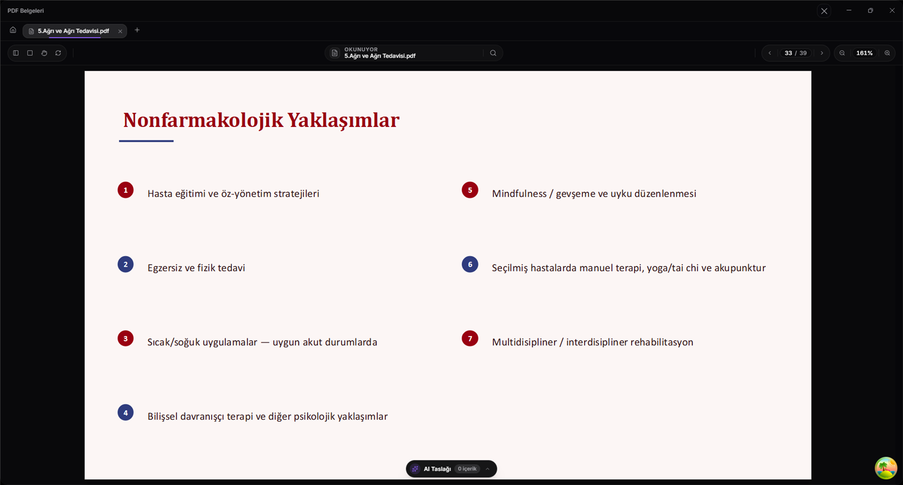
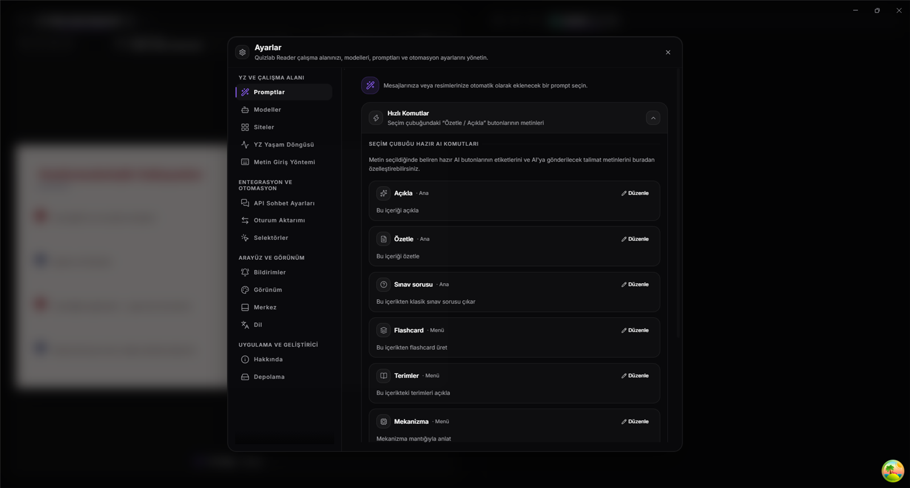
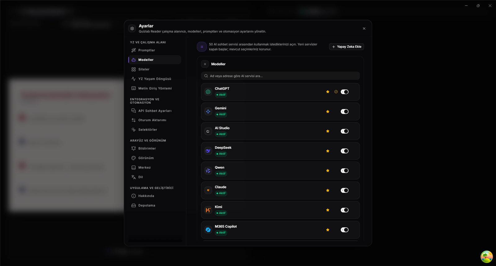
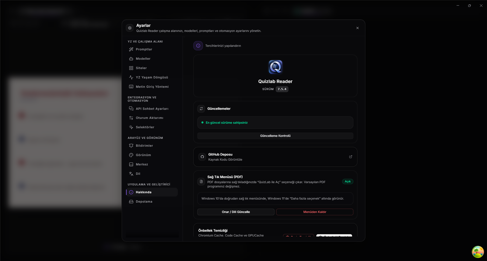
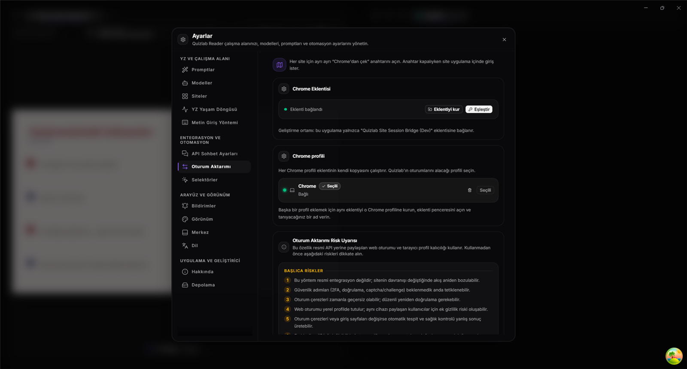
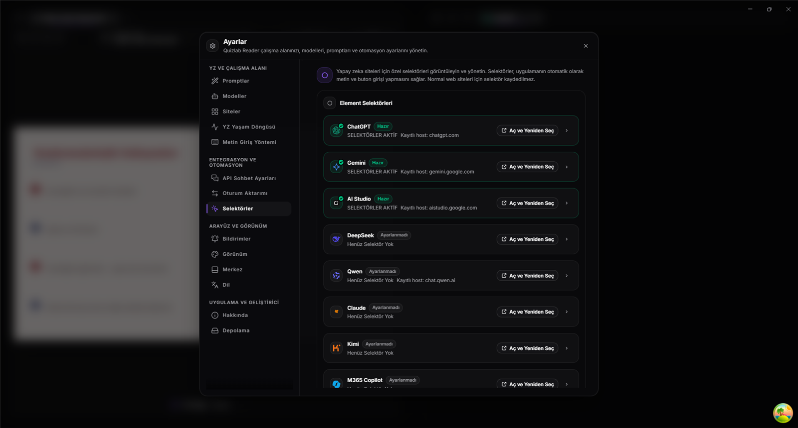
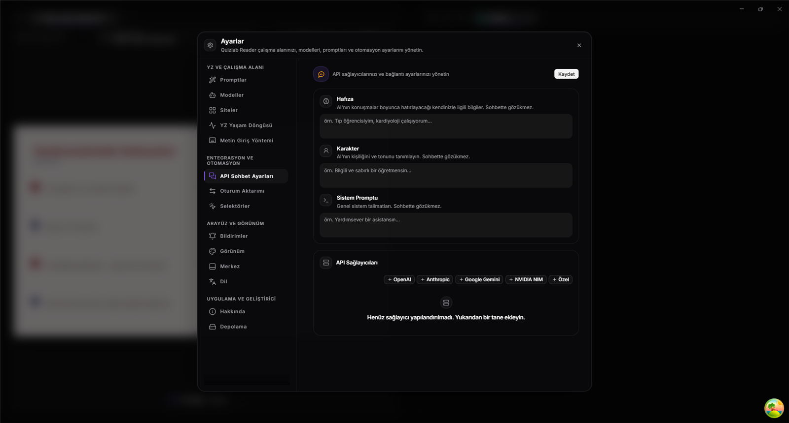
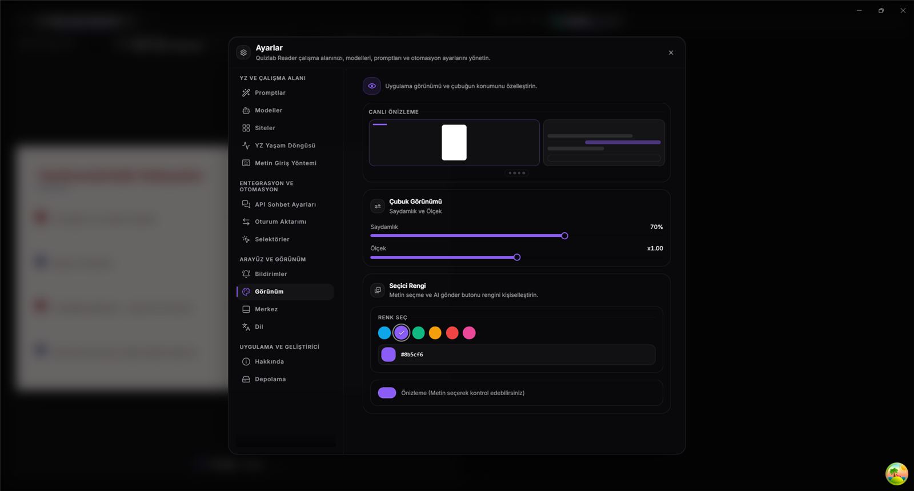

# Quizlab Reader

<p align="center">
  PDF'leri yapay zeka asistanlarıyla yan yana okumak için yerel odaklı masaüstü çalışma alanı.
</p>

<p align="center">
  <a href="README.md">English</a>
  &nbsp;•&nbsp;
  <a href="https://github.com/ozymandias-get/quizlab/releases">Sürümler</a>
  &nbsp;•&nbsp;
  <a href=".github/CONTRIBUTING.md">Katkıda bulunma</a>
  &nbsp;•&nbsp;
  <a href=".github/SECURITY.md">Güvenlik</a>
  &nbsp;•&nbsp;
  <a href="docs/ARCHITECTURE.md">Mimari</a>
  &nbsp;•&nbsp;
  <a href="docs/ROADMAP.md">Yol haritası</a>
  <br>
  
</p>

---

## Genel bakış

Quizlab Reader, bir PDF görüntüleyici ile bir dizi yapay zeka asistanını tek
pencerede tutar. Sol panel çok sekmeli bir PDF çalışma alanıdır; sağ panel ise
sekme sekme düzenlenmiş, her biri ana sürecin yönettiği `WebContentsView` ve
kalıcı Chromium oturum bölümüne sahip yapay zeka oturumlarıdır. Seçilen metin, sayfa
görüntüleri ve kırpılmış ekran görüntüleri yüzen bir gönderme bileşeninde
toplanır ve DOM otomasyonu ile aktif yapay zeka sekmesine iletilir; böylece
okuduğunuz belgeden çıkmak zorunda kalmazsınız.

Uygulama; makale, ders notu ve kitap okuyup bunlar hakkında bir yapay zekaya
sorular soran kişiler için tasarlanmıştır. Paketlenmiş bir analiz (telemetri)
SDK'sı yoktur ve belgeleriniz hiçbir zaman yüklenmez: uygulamanın yazdığı her
şey kendi kullanıcı verisi klasöründe, kendi makinenizde kalır. Ağ trafiği
yalnızca sizin yönlendirdiğiniz yerlerde oluşur: açtığınız yapay zeka siteleri,
yapılandırdığınız model sağlayıcıları, yerel çerez köprüsü ve güncelleme bildirimi
için GitHub Releases sorgusu.

## Ekran görüntüleri

**Çalışma alanı ana ekranı** — kayıtlı tüm modeller ve siteler tek bir başlangıç
panelinde, yanında PDF paneli ve araç merkezi:



**Okuma ve gönderme** — solda bir PDF sayfası, sağda ChatGPT ve gönderme
bileşeninde hazırlanmış PDF metni:



**Odak modu** — aynı belge, AI paneli olmadan tam genişlikte:



**Ayarlar** — ayarlar penceresi sekmelerini "YZ ve Çalışma Alanı", "Entegrasyon
ve Otomasyon", "Arayüz ve Görünüm" ve "Uygulama ve Geliştirici" başlıklarına
ayırır.

Promptlar — hızlı komutlar ve prompt kütüphanesi:



Modeller — kullandığınız modelleri etkinleştirin, sıralayın, sabitleyin ya da
kendi modelinizi ekleyin:



Hakkında — sürüm, güncelleme denetimi, Windows sağ tık menüsü, önbellek temizliği
ve tanılama araçları:



Oturum Aktarımı — site başına "Chrome'dan çek" anahtarları, profil eşleştirme ve
çerez aktarımının riskleri:



Selektörler — Magic Picker'ın site başına kayıtlı seçicileri ve sağlık durumu:



API sohbeti — sağlayıcı şablonları ve isteğe bağlı saklanan talimatlar:



Görünüm — merkez çubuğu saydamlığı/ölçeği ve seçim rengi:



## Özellikler

- **Çok sekmeli PDF çalışma alanı** — belge açma, yeniden adlandırma, kapatma,
  arama, yakınlaştırma, sayfa gezinme, okuma ilerlemesi geçmişi, sürükle-bırak ve
  bir Google Drive sekmesi. PDF'yi sol panele bırakın veya PDF araç çubuğundaki
  dosya seçiciyle açın; aramayı araç çubuğundan açın.
- **Bölünmüş ekran düzeni** — sürüklenebilir ayraç PDF/yapay zeka oranını ayarlar,
  odak modu ise PDF veya yapay zeka tarafından birini tam genişliğe açar.
- **Sekmeli yapay zeka oturumları** — ChatGPT, Gemini, AI Studio, YouTube,
  DeepSeek, Qwen, Claude, Kimi ve M365 Copilot hazır olarak kayıtlıdır;
  NotebookLM Google site grubu üzerinden kullanılabilir (katılım isteğe bağlıdır)
  ve kendi siteleriniz de eklenebilir. Her site kendi kalıcı oturumunda çalışır,
  böylece girişler yeniden başlatmalardan sonra korunur. `API Chat` sekmesi ise
  uygulama içinde çizilen yerel bir sohbet yüzeyi sunar.
- **Gönderme bileşeni** — seçilen metin, sayfanın tamamı metin veya görsel olarak,
  ya da kırpılmış alan görseli kuyruğa alınır ve eklenme sırasıyla tek bir mesajda
  birleştirilir (görseller o tek mesaja ek, tek gönderim). Otomatik Gönderim genel
  bir tercihtir: kapalıyken uygulama yalnızca içeriği hazırlar, gönderme düğmesine
  siz basarsınız.
- **Hızlı istemler** — hazır sekiz ön ayar (açıkla, özetle, quiz, flashcard,
  terimler, mekanizma, klinik, tekrar); gönderilen mesajın başına otomatik bir
  istem ekler. Etiketler ve istem metinleri kullanıcı tarafından düzenlenebilir.
- **Magic Picker** — herhangi bir yapay zeka sitesinde sohbet giriş alanını ve
  gönderme düğmesini CSS yazmadan fareyle seçin. Seçiciler ana makine adına göre
  saklanır ve kendini onarır: kayıtlı seçici bozulduğunda çalışma zamanı yeni bir
  seçici bulur; güven ve titreme denetimlerinden ve üç ardışık başarılı
  gönderimden sonra bunu kalıcılaştırır.
- **Doğrudan API sohbeti** — kendi API anahtarınızı kullanın ve OpenAI uyumlu
  `/chat/completions` ve `/models` uç noktaları üzerinden modellerle konuşun.
  Anthropic, Google ve NVIDIA şablonları dahil tüm sağlayıcılar aynı OpenAI
  biçimli hat protokolünü kullanır; `providerType` yalnızca temel adresi ve giriş
  ipuçlarını seçer. OpenAI, Anthropic, Google ve NVIDIA için hazır sağlayıcı
  şablonları gelir; `custom` ise uyumlu herhangi bir geçidi kapsar. İstekler SSRF
  doğrulaması ve DNS sabitleme ile ana süreçten yapılır (TLS SNI korunur).
  Varsayılan olarak HTTPS zorunludur; düz HTTP yalnızca `localhost`/`127.0.0.1`
  için ve sağlayıcı başına `Yerel ağa izin ver` onayı varsa LAN/yerel-model
  adresleri için açılır. Sohbet istekleri varsayılan olarak 60 sn, model listeleri
  varsayılan 15 sn (en fazla 30 sn) sonra zaman aşımına uğrar; ikisi de sağlayıcının
  `requestTimeout` değerinden türetilir. İstek gövdesi 20 MB, yanıt 50 MB ile sınırlıdır.
- **Site oturumları** — kullandığınız her sitenin **Ayarlar → Oturum Aktarımı**
  bölümünde kendi "Chrome'dan çek" anahtarı bulunur. Anahtar açıkken bu panelden
  kurulan Chrome eklentisi sitenin çerezlerini kendi Chrome profilinizden yerel köprü
  üzerinden devreder; kapalıyken site uygulama içinde doğrudan giriş ister. Her
  site kendi kalıcı Chromium çerez kavanozunda (cookie jar) tek oturum tutar.
  Google ailesi (Gemini, AI Studio, YouTube, NotebookLM ve Google Drive) tek bir
  hesap grubunu paylaşır ve tek satırda birleştirilmiştir.
- **Görünüm** — merkez çubuğunun ayarlanabilir saydamlığı ve ölçeği, kullanıcı
  tarafından seçilen seçim rengi (AI gönder düğmelerini de renklendirir) ve
  araçlar ile modeller için yapılandırılabilir merkez (hub).
- **Dil** — İngilizce ve Türkçe; ilk çalıştırmada seçilir, ayarlardan değiştirilir.
  Dil başına 17 alan adı JSON dosyası vardır.
- **Depolama ve önbellek yönetimi** — ölçülen önbellek toplamı, zamanlanmış temizlik
  (başlangıç, boşta ve 30 dakikalık yineleme) ve 1 GB bütçenin %80'inde uyarı balonu.
- **Güncelleme bildirimi** — başlangıçtan yaklaşık beş saniye sonra GitHub
  Releases API'sini sorgular, basitleştirilmiş sayısal sürüm karşılaştırması yapar
  (ana.alt.yama; ön sürüm etiketleri sıralanmaz) ve sürüm sayfasına bağlantı sunar.
  Hiçbir şey indirmez veya kurmaz.
- **Windows kabuk entegrasyonu** — `.pdf` dosyaları için Gezgin sağ tık menüsünde
  isteğe bağlı bir "QuizLab ile Aç" girdisi; varsayılan PDF uygulamanız değişmez.

## Teknoloji altyapısı

| Alan                    | Seçim                                                                                     |
| ----------------------- | ----------------------------------------------------------------------------------------- |
| Masaüstü çalışma zamanı | Electron 45                                                                               |
| Arayüz                  | React 19; yönlendirici yok (özel durum tabanlı çalışma alanı)                             |
| Dil                     | TypeScript 6                                                                              |
| Derleme                 | Vite 8 (renderer), `tsc` + esbuild (main/preload), electron-builder (paketleme)           |
| PDF motoru              | `pdfjs-dist@6.5.438` + uygulamaya ait native görüntüleyici, worker `pdf.worker.min.mjs`   |
| Stil                    | Tailwind CSS 4 (`@theme` token'ları) ve az sayıda CSS modülü                              |
| Durum                   | Bileşenler arası durum için Zustand 5, IPC üzerinden okumalar için TanStack React Query 5 |
| Arayüz primitifleri     | Radix UI, Headless UI, shadcn/ui, Lucide ikonlar                                          |
| Animasyon / efekt       | Motion, Inter Variable (Fontsource), özel canvas parçacık efektleri                       |
| i18n                    | i18next + react-i18next                                                                   |
| Test                    | Vitest 5 + Testing Library                                                                |
| Lint / biçimlendirme    | ESLint 10, Prettier, Stylelint, cspell, dependency-cruiser                                |
| Güvenlik araçları       | Electronegativity, Semgrep, `npm audit`                                                   |
| Paketleme               | electron-builder 26 — NSIS (Windows), dmg/zip (macOS), AppImage/deb (Linux)               |

## Gereksinimler

**Uygulamayı çalıştırmak için**

- Windows 10/11 (x64) — yayınlanan yükleyici kullanıcı düzeyinde bir NSIS
  paketidir. Gezgin sağ tık menüsü girdisi yalnızca Windows'ta çalışır; yerel
  Chrome çerez köprüsü platform bağımsızdır ve uygulamanın çalıştığı her yerde
  çalışır.
- macOS — `dmg`/`zip` hedefleri yapılandırılmıştır ancak sürüm iş akışı macOS
  derlemesi yapmaz; `npm run build:mac` ile yerelde üretin. Electron 45 (Chromium
  156), macOS 13 (Ventura) ve üzeri için ikili dosya sağlar.
- Linux — AppImage ve `deb` CI tarafından derlenir.
- Yapay zeka özellikleri için ağ bağlantısı gerekir. PDF okumak için başka hiçbir
  şey gerekmez.

**Kaynaktan derlemek için**

- Node.js `24.15+` veya `26+` (CI hem 24 hem 26'yı çalıştırır; alt sınır jsdom
  31'in `engines` aralığından gelir ve Vite ile Vitest'in yayımladığı
  aralıklardan daha katıdır)
- npm — kilit dosyası `package-lock.json`, CI `npm ci` kullanır
- Git
- Yalnızca Google sitelerini (Gemini, AI Studio, YouTube, Google Drive) kullanacaksanız Google hesabı
- Yalnızca doğrudan API sohbetini istiyorsanız API anahtarları
- Yalnızca oturum köprüsü eklentisini istiyorsanız Google Chrome

## Kurulum

Platformunuz için yükleyiciyi [Sürümler](https://github.com/ozymandias-get/quizlab/releases)
sayfasından indirin.

| Platform | Dosya                                                                               |
| -------- | ----------------------------------------------------------------------------------- |
| Windows  | `QuizLab-Setup-<version>-x64.exe` — NSIS, kullanıcı düzeyinde, yönetici gerektirmez |
| Linux    | `.AppImage` (doğrudan çalıştırın) veya `.deb` (`dpkg` ile kurun)                    |
| macOS    | CI derlemez — `npm run build:mac` ile yerelde üretin                                |

Windows yükleyicisi imzasızdır, bu yüzden ilk çalıştırmada SmartScreen uyarısı
gösterebilir. Kullanıcı düzeyinde kurulur, hiçbir zaman yetki istemez ve
kaldırma sırasında `%AppData%\Quizlab Reader` yerinde kalır. İsteğe bağlı Gezgin
sağ tık girdisi `SystemFileAssociations\.pdf` altına kullanıcı düzeyinde
kaydedilir; varsayılan PDF uygulaması değişmez. Kod imzalama değişkenleri dahil
ayrıntı için [docs/windows-installer.md](docs/windows-installer.md) dosyasına bakın.

## Yapılandırma

Neredeyse her şey uygulama içinden yapılandırılır. Düzenlenecek bir yapılandırma
dosyası ve bir `.env` yükleyicisi yoktur: Electron ana süreci doğrudan
`process.env` okur, dolayısıyla değişkenleri onu başlatan kabukta dışa aktarmanız
gerekir. `.env.example` varsayılanlarla birlikte listenin tamamını belgeler;
geliştirmede önemli olanlar:

| Değişken                        | Etkisi                                                                                                    |
| ------------------------------- | --------------------------------------------------------------------------------------------------------- |
| `APP_RENDERER_URL`              | Ana pencerenin yüklediği geliştirme sunucu adresi (varsayılan `http://localhost:5173`)                    |
| `APP_OPEN_DEVTOOLS=1`           | Başlangıçta DevTools'u aç                                                                                 |
| `QUIZLAB_PROFILE`               | Kullanıcı verisi dizini son eki (aşağıya bakın)                                                           |
| `QUIZLAB_USER_DATA_DIR`         | Kullanıcı verisi için mutlak yol geçersiz kılma                                                           |
| `QUIZLAB_DISABLE_GPU=1`         | Donanım hızlandırmayı kapat                                                                               |
| `QUIZLAB_EXTENSION_BRIDGE_PORT` | Chrome çerez köprüsü için yerel port; kurulu uygulama `51999-52009`, `npm run dev` `52010-52020` kullanır |

`stable` dışında bir `QUIZLAB_PROFILE` kullanmak tek örnekli kilidi de devre dışı
bırakır; bu, iki profili yan yana çalıştırmak için kullanışlıdır.

**Veriler nerede durur.** Uygulama her şeyden önce kullanıcı verisi dizinini
taşıdığı için profiller birbirine karışmaz:

| Profil   | Dizin                                                              |
| -------- | ------------------------------------------------------------------ |
| `stable` | `<appData>/Quizlab Reader` — Windows'ta `%AppData%\Quizlab Reader` |
| `dev`    | `<appData>/Quizlab Reader Dev` (paketlenmemiş çalıştırmalar)       |
| diğer    | `<appData>/Quizlab Reader <profil>`                                |
| geçersiz | `QUIZLAB_USER_DATA_DIR`                                            |

Bu dizinin içinde: JSON yapılandırma dosyaları, `Partitions/<ad>/` Chromium
oturum ve önbellek verisi, `logs/` ve Chrome eklentisiyle paylaşılan köprü gizli
anahtarı. Eklenti uygulamayla birlikte `resources/extension` olarak gelir;
**Ayarlar → Oturum Aktarımı** altındaki Kur düğmesi onu kullanıcı veri
dizinindeki sabit bir klasöre kopyalar. CI ayrıca bağımsız bir
`quizlab-session-extension.zip` yayımlar. Veritabanı yoktur.

**API anahtarları** `api_chat_config.json` içinde saklanır (POSIX'te `0600`
modunda yazılır; Windows ACL'leri değişmez); işletim sistemi anahtar deposu varsa
Electron `safeStorage` ile, yoksa makine parmak izinden PBKDF2 ile türetilen
anahtarla AES-256-GCM kullanılarak şifrelenir. Yedek yöntem değeri diskte yalnızca
gizler; makine profilinize erişimi olan biri için anahtar deposunun yerine geçmez.

## Kullanım

1. Uygulamayı başlatın. İlk çalıştırmada dil seçin.
2. PDF'yi sol panele bırakın veya PDF araç çubuğundaki dosya seçiciyle açın. Belge
   başına bir sekme açılır.
3. Sağdaki ana panelden bir yapay zeka sitesi açın veya **Ayarlar → Siteler**
   altından kendi sitenizi ekleyin. Bir kez giriş yapın; oturum hatırlanır.
4. PDF içinde metin seçin veya sayfaya sağ tıklayıp _Bu Sayfanın Metnini AI'ye
   Ekle_ / _Sayfayı Görsel Olarak AI'ye Ekle_ / _Alan Seçerek Görseli AI'ye Ekle_
   seçeneklerinden birini kullanın.
5. İçerik gönderme bileşeninde birikir ve eklenme sırasıyla tek bir mesajda
   birleştirilir. İsterseniz bir hızlı istem seçin, sonra **Send to AI** düğmesine
   basın.
6. Her seferinde sitede gönder düğmesine basmak istemiyorsanız bileşendeki
   **Otomatik Gönderim** anahtarını açın.
7. Bir sitenin düzeni değişirse o sekmede **Magic Picker**'ı çalıştırıp giriş
   alanını yeniden seçin. Siz seçene kadar uygulama yanlış öğeye yazmak yerine
   göndermeyi reddeder.

## Mimari

```
Renderer (src/)
  React çalışma alanı: PDF paneli, AI host placeholder bileşenleri,
  gönderme bileşeni, ayarlar
  AiContentController: uzak komutlar ve generation filtreli durum
  hook'lar + window.electronAPI üzerinde TanStack Query
         |  tipli invoke (kanal -> istek/sonuç tipleri)
         v
Preload (electron/preload/)
  contextBridge: açık izin listesi — jenerik invoke(channel, ...) geçidi yok
         |  ipcRenderer.invoke
         v
Main (electron/)
  tipli ipcMain handler'ları; sözleşmedeki her handler'da güvenilir gönderici kontrolü
  (ekran paylaşımı seçicisi örnek başına ayrı kanallar kullanır)
  özellik modülleri: ai-view, ai, automation, native-messaging,
                     pdf, screenshot, settings, shell-open, web-session
  core: yapılandırma deposu, şifreleme, CSP, günlükleme, önbellek, güncelleyici
         |
         +--> local-pdf:// protokolü -> yerel PDF dosyaları (izin listesi, bayt aralıkları)
         +--> AiWebContentsViewManager -> WebContentsView / sağlayıcı bölümleri
         |                            uzak komutlar ve olay köprüsü
         +--> remoteContentSecurity -> gezinme, popup, TLS, pano
         +--> permissionPolicy      -> bölüm + kayıtlı kaynak izinleri
         +--> model sağlayıcı HTTP -> doğrudan API sohbeti (SSRF doğrulamalı)
         +--> GitHub Releases API  -> güncelleme bildirimi
```

Ortak sözleşmeler `shared/` dizinindedir: kanal adları
(`shared/constants/ipcChannels.ts`, 67 kanal) ve istek/sonuç haritası
(`shared/types/ipcContract.ts` — `IpcInvokeRequestMap` ve `IpcEventMap`).
`@shared-core/*` alias'i tsconfig ve Vite'ta `shared/` dizinine çözülür;
renderer kodu ve testler bu alias'i kullanır, preload ve ana süreç çalışma zamanı
içe aktarımları ise göreli `.js` yollarını kullanır.

Değişiklik yapmadan önce bilinmesi gereken iki tasarım noktası: gezinme durumdur,
yönlendirme değil — bir yönlendirici yoktur ve PDF sekmeleri (Zustand) ile
yapay zeka sekmeleri (bölünmüş context'ler arkasında `useState`) birbirinden
bağımsızdır; web oturumu otomasyonu `AiContentController` ve tipli IPC üzerinden
ana süreçte üretilen betikleri yönetilen uzak görünümde çalıştırır. API Sohbet
sağlayıcı HTTP isteklerini kullanır.

Host sahipliği ile içerik yaşam döngüsü bağımsızdır. Host placeholder kaldırılınca
sahiplik token'ı bırakılır ve native görünüm gizlenip sessize alınır; görünüm yok
edilmez. Odak modu aynı generation, URL ve sayfa durumunu yeniden yüklemeden
kullanır. Sekme kapatma, LRU çıkarma ve uyku yönetilen görünümü yok eder;
uyandırma yeni generation'lı bir görünüm ekler ve ilk yükleme tamamlanana kadar
gizli tutar. Varsayılan `maxAliveTabs` değeri 1'dir; sekme değiştirmek normalde
önceki görünümü de kapatır, daha fazlasını canlı tutmak için bu değeri artırın.
Host sınırları tek animasyon karesinde birleştirilir; dialog, örtü, sekme geçişi
veya odak açılışı sırasında native görünüm gizlenir.

Katman sınırları, dependency-cruiser'ın uyguladığı import kuralları ve seçici
kendini onarma akışı için [docs/ARCHITECTURE.md](docs/ARCHITECTURE.md)
dosyasına bakın.

## Proje yapısı

```
electron/            Ana süreç
  app/               Giriş noktası, pencere oluşturma, oturum/CSP/güvenlik, IPC bağlantısı
  core/              Yapılandırma deposu, şifreleme, günlükleme, önbellek, güncelleyici, tipli IPC
  features/          Özellik handler'ları (ai, automation,
                     native-messaging, pdf, screenshot, settings, shell-open,
                     web-session)
  preload/           contextBridge yüzeyi
  __tests__/         Ana süreç testleri
shared/              Süreçler arası sözleşmeler: IPC kanalları, tipler, sabitler
src/                 Renderer
  app/               Kabuk, sağlayıcılar, uygulama efektleri, yüzen gönderme bileşeni
  features/          ai, automation, onboarding, pdf, screenshot, settings
  platform/electron/ Uygulama ile window.electronAPI arasındaki adaptörler
  shared/            Paylaşılan arayüz, hook'lar, i18n, stiller, store'lar, lib
  __tests__/         Renderer testleri
extensions/          Site oturum köprüsü için Chrome eklentisi
installer/           NSIS özel yükleyici mantığı
scripts/             Geliştirme ve derleme otomasyonu
docs/                Mimari, kodlama standardı, terminoloji, yol haritası
```

## Geliştirme

```bash
git clone https://github.com/ozymandias-get/quizlab.git
cd quizlab
npm install
npm run dev          # Vite geliştirme sunucusu + Electron
```

`npm run dev` ana süreci derler, Vite'ı 5173 portunda başlatır (bu uygulama
orada zaten sunuluyorsa onu yeniden kullanır) ve ardından Electron'u çalıştırır.
Electron'un stderr çıktısındaki bilinen Chromium gürültüsünü süzer, geri kalanı
olduğu gibi yazar.

Diğer giriş noktaları:

| Komut                  | Ne yapar                                                          |
| ---------------------- | ----------------------------------------------------------------- |
| `npm run dev:web`      | Yalnızca Vite; renderer bir tarayıcıda sahte API'ye karşı çalışır |
| `npm run dev:electron` | Arka uç derlemesi, sonra çalışan geliştirme sunucusuna Electron   |

Kalite kapıları — hepsi CI'da çalışır:

```bash
npm run typecheck     # tsc -b (app, node, node.test projeleri)
npm run lint          # ESLint, uyarı sıfır toleranslı
npm run format:check  # Prettier
npm test              # Vitest, tüm paket
npm run test:coverage # Vitest + eşiklerle coverage
```

CI'da bloklayıcı olan beş komut düzeyi kapı daha var (iş akışındaki lint, format,
typecheck ve analiz adımlarına ek olarak); bunları da yerelde çalıştırın, yoksa
etiketli bir sürüm hiç anılmamış bir kapıda durur:

```bash
npm run ci:check-hygiene        # takip edilen build çıktısı ve taşınabilir olmayan git yolu yok
npm run ci:check-version        # sürüm rozeti + etiket ↔ package.json
npm run ci:check-declarations   # Node tabanı ve bağımlılık tabanları ↔ kurulu ağaç
npm run check:audit             # üretim bağımlılık uyarıları
npm run check:electron-security # Electron yüzeyinde Electronegativity
```

Analiz araçları:

```bash
npm run analyze:architecture  # dependency-cruiser import kuralları
npm run analyze:circular      # madge
npm run analyze:duplicates    # jscpd
npm run analyze:deadcode      # knip
npm run analyze:types         # type-coverage
npm run analyze:css           # stylelint
npm run analyze:security      # Semgrep + npm audit + Electronegativity
npm run analyze:all           # yukarıdakilerden analyze:css hariç tümü; analyze:css ve analyze:bundle ayrı çalışır
```

Commit mesajları [Conventional Commits](https://www.conventionalcommits.org/)
biçimini izler ve Husky `commit-msg` kancasındaki commitlint ile denetlenir.
Husky `pre-commit` kancası ayrıca `ci:check-hygiene`'i (bloklayıcı),
`ci:check-version`, dosya boyutu ve CSS denetimlerini (bloklayıcı olmayan) ve
ardından lint-staged'i çalıştırır.

## Test

Vitest 5, `vitest.config.mts` içinde iki proje çalıştırır: `renderer` projesi
`src/__tests__/` ile DOM kullanan `electron/__tests__/` paketlerini (automation,
ai-view, settings ve kök düzeyindeki testler) `jsdom`'da; `main` projesi ise
`electron/__tests__/app`, `/core`, `/preload` ve
`/features/{ai,pdf,screenshot,web-session,native-messaging,shell-open}` paketlerini
Node'da çalıştırır. Güncel dosya ve test sayısı için `npm test` çalıştırın — bu
sayılar her commit ile değiştiği için burada kasıtlı olarak tekrarlanmıyor.

Coverage eşikleri `vitest.config.mts` içinde kapsam başına uygulanır — genel
olarak satır için %50, ayrıca `electron/features/web-session`,
`electron/features/automation`, `electron/core`,
`electron/features/ai/apiChatHandlers` ve PDF özelliği için ayrı tabanlar.
`npm run analyze:mutation` ile Stryker çalıştırılır.

## Derleme

```bash
npm run build         # renderer + main + preload -> dist/
npm run build:web     # yalnızca renderer, tarayıcı önizlemesi için
npm run build:win     # ardından electron-builder --win  -> release/*.exe
npm run build:mac     # ardından electron-builder --mac  -> release/*.dmg, *.zip
npm run build:linux   # ardından electron-builder --linux -> release/*.AppImage, *.deb
```

Paketleme çıktısı `release/` dizinine gider. `app.asar` içine yalnızca `dist/**`
konur; ikonlar ve Chrome eklentisi ek kaynak olarak dağıtılır. Eklenti ayrıca
sürümlerde bağımsız bir zip yapıtı olarak yayımlanır. Windows derlemeleri
varsayılan olarak imzasızdır (`signExecutable: false`, `forceCodeSigning: false`);
imzalamak için `CSC_LINK` / `CSC_KEY_PASSWORD` (veya `WIN_CSC_LINK`) tanımlayın —
ayrıntı için [docs/windows-installer.md](docs/windows-installer.md) dosyasına bakın.

## CI/CD

`.github/workflows/build.yml` dört iş içerir ve yalnızca sürüm odaklıdır: `v*`
etiketlerinde ve elle `workflow_dispatch` ile çalışır. Normal dal push'u veya
pull request bu iş akışını tetiklemez.

1. **quality** (ubuntu-latest, Node 24) — depo hijyeni, bildirim ve sürüm
   tutarlılığı, ESLint, Prettier, CSS lint, typecheck, dependency-cruiser, knip
   ölü kod tespiti, coverage'lı testler, type-coverage denetimi, kopya kod ve
   döngüsel bağımlılık tespiti, tam build, Semgrep, üretim bağımlılık denetimi ve
   Electronegativity. Dosya boyutu ve yazım denetimi `continue-on-error: true` ile
   çalışır, engelleyici değildir.
2. **quality-node-26** (ubuntu-latest) — Node 26'da kurulum, typecheck ve testler.
   `build` buna bağlıdır; buradaki hata sürümü engeller.
3. **build** (windows-latest ve ubuntu-22.04; etiketlerde veya elle tetiklemede) —
   Windows ve Linux yükleyicilerini üretir ve yapıtları artifact olarak yükler.
4. **release** (ubuntu-latest, yalnızca etiketlerde) — iki yapıt kümesini indirir,
   `quizlab-session-extension.zip` dosyasını ekler; özel indirme/özellik gövdesi
   ve ardından GitHub'ın ürettiği notlarla herkese açık, prerelease olmayan bir
   GitHub Release oluşturur.

`ci:check-version` `v*` etiketini `package.json` ile karşılaştırır (`X.Y.0` için
`vX.Y` kısaltmasına izin verir) ve her iki README'deki dinamik sürüm rozetini
doğrular. Elle tetiklemede 1–3. işler çalışır, sürüm oluşturulmaz.

## Güvenlik ve gizlilik

Bu derlemenin doğrulanmış özellikleri:

- **İzole renderer** — `contextIsolation: true`, `nodeIntegration: false`,
  `sandbox: true`, `webSecurity: true` ve `webviewTag: false`. Ana süreç uzak
  `WebContentsView` örneklerini güvenli tercihlerle ve Node erişimi olmadan oluşturur.
- **Ana sürecin yönettiği uzak görünümler** — `AiViewTarget`, kaynak ve bölümleri
  ana süreç kayıtlarından çözer. Tipli IPC sınırlı görünüm kimliği, host token,
  sınır ve komut kabul eder; renderer bölüm, preload, WebContents kimliği veya
  güvenlik tercihi gönderemez. Ayrı bir önbellek temizleme kanalı, ana sürecin
  çözümlenip korumalı bölümlere karşı denetlediği bir bölüm anahtarı kabul eder.
- **Uzak içerik politikası** — ana çerçeve gezinmesi HTTPS gerektirir; popup
  reddedilir ve doğrulanmış adres harici tarayıcıya aktarılır. `permissionPolicy`
  bölüm ile kayıtlı kaynağı denetler; TLS sertifika hataları reddedilir. Pano
  koruması güvenilir kullanıcı/uygulama yapıştırmasını korurken programatik erişimi engeller.
- **Dar preload köprüsü** — 67 kanal üzerinde yaklaşık 74 adlandırılmış metot;
  jenerik IPC geçidi yok. `get-automation-scripts` tek kanal altında altı metoda
  açılır; `getPathForFile` ve `platform` doğrudan `webUtils`/`process` okuyor,
  olay kanalları `on()`/`send()` ile sarılır.
- **Gönderici doğrulaması** — ortak IPC sözleşmesindeki her handler ana pencerenin
  ana çerçevesini zorunlu tutar (WebContents kimliği, izinli ana çerçeve URL'si,
  ana çerçeve kontrolü). Ekran paylaşımı seçici ayrı bir pencere ve örnek başına
  kanallar kullanır, kendi WebContents'ini doğrular.
- **Analiz yok** — telemetri veya çökme bildirimi SDK'sı paketlenmez ve kullanıcı
  verisi otomatik gönderilmez. Tek otomatik giden istek, güncelleme bildirimi için
  GitHub Releases sorgusudur. Çökme raporları kullanıcı verisi klasöründeki
  `logs/` altına yazılır ve korunur; dönen `quizlab-*.log` dosyaları 7 gün sonra
  silinir.
- **PDF teslimi** — `local-pdf://`, süreç içi bir kayıt deposundaki opak kimlikleri
  çözer, dosyanın izin listesinde olmasını ister, istek kaynağını doğrular ve
  bayt aralıkları sunar.
- **Katı CSP** — paketlenmiş derlemelerde ana çerçeveye nonce tabanlı bir politika
  enjekte edilir; geliştirme derlemelerinde nonce'suz `unsafe-inline` CSP kullanılır.
  İkisi de `frame-src` izin listesi bildirir.
- **Giden istek sertleştirmesi** — API sohbeti adresleri HTTPS olmalı; istisna,
  `localhost`/`127.0.0.1` ve sağlayıcının yerel ağ erişimini açıkça onaylaması
  durumunda LAN/ULA adresleridir. Adresler özel ve özel kullanım alanlarına karşı
  denetlenir (link-local/metadata, onay olsa da engelli kalır), TLS SNI korunarak
  çözülen IP'ye sabitlenir ve beş aynı kaynaklı yönlendirmeyle sınırlıdır.
  Farklı kaynağa yönlendirmeler reddedilir; gövdeli bir isteği GET'e çeviren
  301/302/303 `Authorization` başlığını düşürür (307/308 korur).
- **Köprü kimlik doğrulaması** - çerez köprüsü tam bir eklenti kaynağı ister,
  gövdeyi eklentiyle paylaşılan eşleştirme koduyla HMAC-SHA256 ile imzalar ve
  sabit zamanlı karşılaştırır, 512 KB gövde sınırı uygular ve çerez alan adı
  izin listesi kullanır. Kurulu uygulama ile `npm run dev` ayrı port aralıkları,
  eklenti kimlikleri, kaynakları ve kullanıcı verisi dizinleri kullanır; köprüleri
  ve eşleştirme anahtarları hiçbir zaman birbirine karışmaz.
- **Electronegativity ve Semgrep** CI'da çalışır.

Bunların size **sağlamadığı** şeyler: canlı yapay zeka oturum çerezleri
Chromium'un kendi bölüm deposunda saklanır ve uygulama tarafından şifrelenmez;
makine kaynaklı AES anahtarı gizlemedir, makine profilinize erişimi olan birine
karşı koruma değildir; ve derlemeler imzasızdır.

## Katkıda bulunma

Kurulum, dal stratejisi, pull request kontrol listesi ve
[docs/CODING_STANDARD.md](docs/CODING_STANDARD.md) içindeki yazım kuralları için
[CONTRIBUTING.md](.github/CONTRIBUTING.md) dosyasına bakın.

## Lisans

[MIT](LICENSE) © Quizlab Reader katkıda bulunanları.
